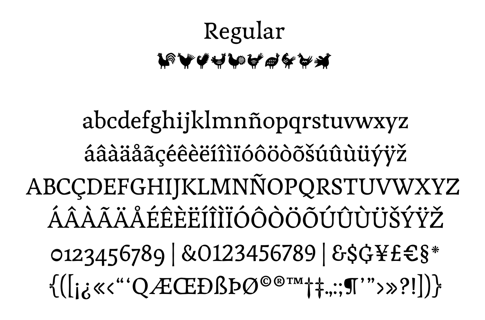
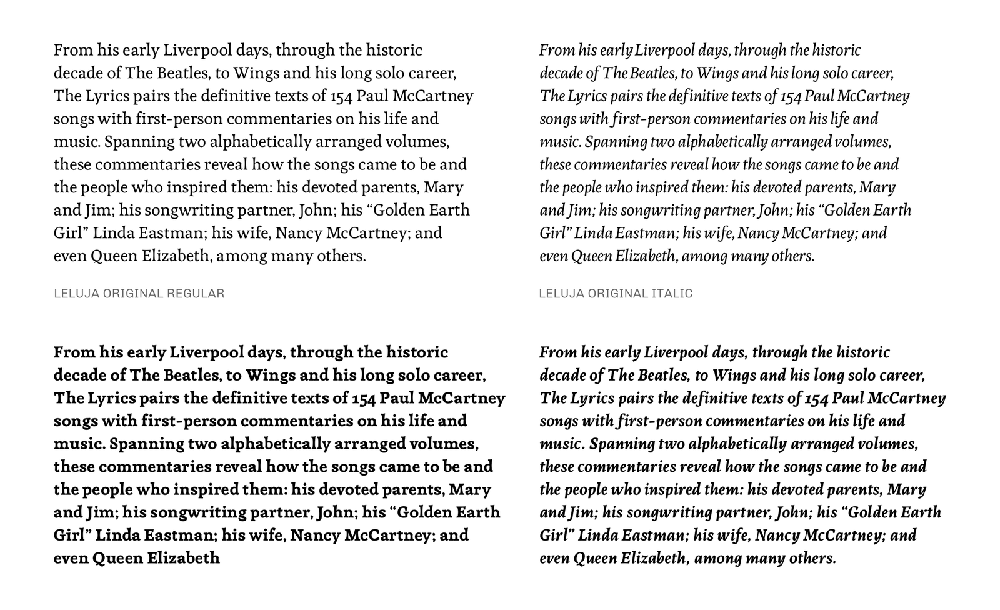
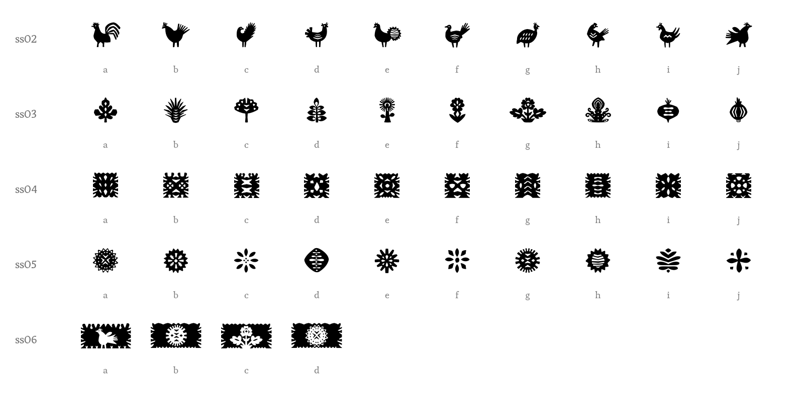

# Leluja Original

**Andrea Kulpas & Omnibus-Type Team**
*SIL Open Font License 1.1 · 4 fonts · 456 glyphs each*


Leluja Original is a typeface family in four styles: Regular, Italic, Bold and Bold Italic. It is meant for printed texts but also performs well in titles.

Its forms and counterforms are inspired by *wycinanki*, the Polish art of paper cutting, traditionally used to decorate windows, beams and holiday cards: monochromatic in the Kurpie style, colorful and layered in the Łowicz style.

The project was developed by Andrea Kulpas and Omnibus-Type, a Brazil/Argentina partnership.

## Styles


| Style | Weight (CSS) | Files |
|---|---|---|
| Regular | 400 | `LelujaOriginal-Regular` |
| Italic | 400 italic | `LelujaOriginal-Italic` |
| Bold | 700 | `LelujaOriginal-Bold` |
| Bold Italic | 700 italic | `LelujaOriginal-BoldItalic` |





## Ornaments

Leluja Original includes **44 ornaments** inspired by wycinanki: roosters and birds, plants, square paper cuts, rosettes and wide panels. They are in every style and are activated through stylistic sets, typing the letters **a** to **j**:

| Set | Letters | Ornaments |
|---|---|---|
| `ss02` | a–j | Roosters and birds |
| `ss03` | a–j | Plants and flowers |
| `ss04` | a–j | Square paper cuts |
| `ss05` | a–j | Rosettes and stars |
| `ss06` | a–d | Wide panels |

For example, “abcdefghij” with `ss02` on gives a row of ten birds. In InDesign or Illustrator, turn on the stylistic set from the OpenType panel; on the web, use `font-feature-settings: 'ss02' 1;`.



## OpenType features

- **Stylistic set** `ss01`: alternate **Q**, **&**, **?** and **¿**.
- **Ornaments:** `ss02` to `ss06` (see above).
- **Figures:** lining and old-style (`lnum`, `onum`), tabular and proportional (`tnum`, `pnum`).
- **Fractions** (`frac`), **superiors and inferiors** (`sups`, `subs`, `sinf`), **ordinals** (`ordn`), case-sensitive forms (`case`) and **fi**, **fl** ligatures (`liga`).

## Files

| Folder | Use |
|---|---|
| `otf/` | Desktop (recommended) |
| `ttf/` | Desktop and apps |
| `woff2/` | Web |
| `Leluja-Original_Specimen.pdf` | Two-page A3 specimen |

### Web use

```css
@font-face {
  font-family: 'Leluja Original';
  src: url('LelujaOriginal-Regular.woff2') format('woff2');
  font-weight: 400;
  font-style: normal;
  font-display: swap;
}
@font-face {
  font-family: 'Leluja Original';
  src: url('LelujaOriginal-Italic.woff2') format('woff2');
  font-weight: 400;
  font-style: italic;
  font-display: swap;
}
```

Repeat the rules for Bold and Bold Italic (`font-weight: 700`).

## Credits

- **Design:** Andrea Kulpas & Omnibus-Type Team
- **Awards:** Leluja Regular, Tipos Latinos Biennial 2016 · Leluja Dingbats, Tipos Latinos Biennial 2022

More about the typeface: [omnibus-type.com/fonts/leluja-original](https://www.omnibus-type.com/fonts/leluja-original/)

## License

Copyright © 2022 The Leluja Project Authors.

Licensed under the [SIL Open Font License, Version 1.1](OFL.txt). You can use, study, modify and redistribute the fonts freely, including in commercial work, as long as they are not sold on their own.
